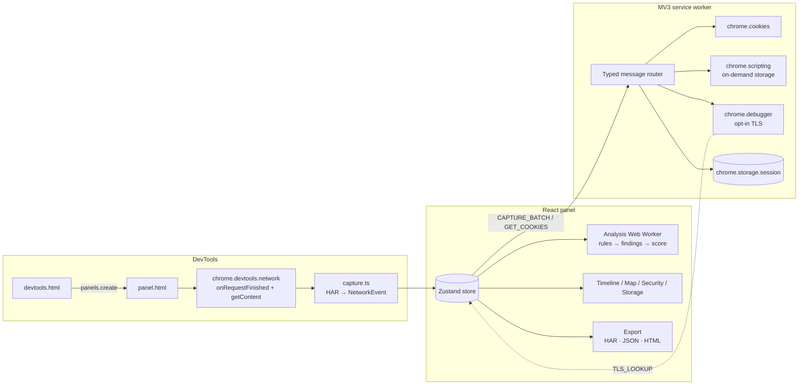

# NetXRay

**X-ray vision for your web app's network traffic.** NetXRay is a Chromium DevTools extension (Chrome, Edge, Brave, Opera, Vivaldi) that turns every request into an animated lifecycle and explains, in plain language, what is insecure about it, and how to fix it.

Built for junior and mid-level full-stack developers who can ship an app but have never had to reason about what happens on the wire. Everything runs locally: no telemetry, no remote servers, no network calls from the extension itself.

```
Browser ──┬── DNS ── TCP ── TLS ── request ── TTFB ── download ──┬── Server
          └──────────── the pipe you can finally see ────────────┘
```

## User guide

New to NetXRay? Read [`docs/usage.md`](docs/usage.md). It covers what the tool is for, when you need it, how to install it, how to read every view, and what to do with a finding.

## What it does

### 1. Animated request lifecycle
Every captured request is split into its real phases, measured by the browser: queued/blocked, DNS, TCP connect, TLS handshake, request upload, waiting (TTFB) and download. Click a request to open a drawer with a packet moving through a pipe between Browser and Server, real timings, headers, cookies, IP, protocol and size.

Turn on **Teach me** for one line per phase, for example:
> **DNS:** the browser asks a resolver for the server's IP address, like looking up a phone number.

### 2. A rule-based security analyzer

**V1 makes four attack claims, at high confidence only.** A finding in one of
these classes requires direct evidence on the wire:

| Attack class | What the panel must see |
| --- | --- |
| **Session hijacking** | A session-like cookie readable by page scripts, or missing `Secure` on an HTTPS page |
| **Cross-origin data theft** | A reflected `Origin`, or `Access-Control-Allow-Origin: *` with credentials |
| **Clickjacking** | An HTML document with no effective `X-Frame-Options` / `frame-ancestors` |
| **Credential leakage** | A secret in a URL or body, an unsigned JWT, or sensitive JWT claims |

Rules that are useful but easier to misread (generic cookie flags, CSP, HSTS,
TLS, trackers, cache policy) stay available as **extended checks**. Enable
*Extended checks* in the Security view or Settings. The full rationale and the
precision/recall benchmark are in [`docs/accuracy.md`](docs/accuracy.md).

34 independent rules run on every request/response. Each finding answers four questions: **what is it**, **why does it matter**, **how could an attacker use it**, and **how do I fix it**, with copy-ready snippets for Express, Next.js and Nginx.

| Group | Rules |
| --- | --- |
| Cookies (5) | missing HttpOnly · script-readable session cookie · missing Secure · missing/weak SameSite · subdomain-wide scope |
| Headers (8) | missing/weak CSP · missing/weak HSTS · missing nosniff · missing clickjacking protection · missing Referrer-Policy · missing Permissions-Policy |
| CORS (3) | wildcard + credentials · reflected Origin · permissive methods/headers |
| Transport (2) | mixed content · plain-HTTP document |
| TLS (4) | outdated protocol · weak cipher · certificate expiring/expired · hostname mismatch |
| Data leaks (4) | secret in URL · secret in response body · verbose stack traces · server/version banners |
| JWT (4) | `alg=none` · missing `exp` · >30-day lifetime · sensitive payload claims |
| Third party (3) | known tracker · third-party origin inventory · missing Subresource Integrity |
| Caching (1) | sensitive response is cacheable |

TLS rules use `chrome.debugger` only after you explicitly enable **Deep TLS inspection** (see permissions).

### 3. Four views
1. **Timeline**: virtualized waterfall for 1,000+ requests, phase bars, severity badges, detail drawer.
2. **Map**: a D3 force graph of every domain the page talks to, sized by traffic and coloured by worst finding.
3. **Security**: 0–100 score, findings grouped by severity, filter chips, full finding drawer.
4. **Storage**: cookies with risk badges, plus on-demand `localStorage`/`sessionStorage` reading.

### 4. Export and share
- **HAR**: the standard format for other tools (contains raw data; treat it as sensitive).
- **JSON report**: normalized events, score and findings with masked secrets.
- **Self-contained HTML report**: one file, inline CSS/JS, no external requests. Safe to drop in a ticket.

## Install

Requirements: Node 20+ and a Chromium browser (Chrome 116+, Edge, Brave, Opera or Vivaldi). Browser support details: [`docs/browsers.md`](docs/browsers.md).

```bash
npm install
npm run build
```

1. Open `chrome://extensions` (or `edge://extensions`, `brave://extensions`, …) and enable **Developer mode**.
2. Click **Load unpacked** and select the `dist/` folder.
3. Open DevTools on any page → **⋮ → More tools → NetXRay**.
4. Reload the page with the panel open to populate the timeline.

### Firefox or Safari

Those browsers do not run a Chrome DevTools extension. Export a HAR from their
DevTools (**Network → Export HAR**) and use **Export ▾ → Import HAR from any
browser…** in the panel. The same four attack checks, extended rules, timeline
and reports run on that capture. See [`docs/browsers.md`](docs/browsers.md) for
the exact steps and what a native port would need.

For development with HMR of the panel UI:

```bash
npm run dev   # Vite dev server for iterating on the UI
npm run build # always reload dist/ in chrome://extensions for extension testing
```

## Try the demo

The repo includes an intentionally vulnerable Express app with a fixed variant:

```bash
npm run demo        # http://localhost:4000 (vulnerable by default)
npm run demo:fixed  # same app with fixes applied
```

Open <http://localhost:4000/vulnerable/>, start the NetXRay panel and click the buttons. Switch to `/fixed/` to watch the findings disappear. The app covers insecure cookies, wildcard CORS with credentials, a token in the URL, missing headers, verbose errors, leaked keys and an `alg=none` JWT.

## Accuracy: precision before coverage

V1 deliberately reports less than it could. The four attack classes above are
the only claims the panel makes by default, and every one of them is backed by
a labelled test: `src/core/accuracy.test.ts` asserts **100% recall** (all 9
labelled hits) and **100% precision** (no extra findings) on a vulnerable
profile, and **zero findings** on the hardened profile. It also covers the
common traps: preference cookies, same-origin CORS echoes, correctly signed
short-lived tokens, and framing headers that look protective but allow any
origin.

Detection is deterministic and explainable. There is **no machine learning in
v1**. With no labelled traffic corpus it would add false positives and make
findings harder to justify. The confidence catalog is the seam where a local
model can be measured against the same benchmark in a later version. The full
method and residual limits are in [`docs/accuracy.md`](docs/accuracy.md).

## Permissions (and why each one exists)

| Permission | Type | Why NetXRay needs it | What it does *not* do |
| --- | --- | --- | --- |
| `cookies` + `<all_urls>` host access | required | Read cookie attributes (`HttpOnly`, `Secure`, `SameSite`, scope) for the page you inspect. Host access is also what lets Chrome read cookies for arbitrary origins. | It never writes, deletes or sends cookies. |
| `storage` | required | Keep a crash-recovery snapshot of the current session per tab in `chrome.storage.session`. | Sessions are cleared when the browser closes; bodies are never persisted. |
| `scripting` | required | Run a tiny, fixed function **only when you press “Read page storage”** to list `localStorage`/`sessionStorage` keys. | It never injects content scripts automatically, never evaluates page strings and never modifies the page. |
| `debugger` | **optional**, requested on demand | Obtain `securityDetails` (TLS version, cipher, certificate validity/SAN) for deep TLS findings. | It is only attached while you enable it; Chrome shows a debugging infobar. Disable it any time in Settings. |
| DevTools panel APIs | implicit | `chrome.devtools.network` provides timings, headers and bodies for the inspected tab. | No access outside the DevTools panel you opened. |

There is no `tabs`, `webRequest`, `history`, `identity` or `<all_urls>` content-script access beyond what is listed.

## Privacy and safety

The full policy is a single static page: [`docs/privacy/index.html`](docs/privacy/index.html) (host it as described in [Publishing the privacy policy](#publishing-the-privacy-policy)).

- **Local-only analysis.** Rules run in a Web Worker in the panel; no data is uploaded. There is no telemetry and the extension makes no outbound requests of its own.
- **Redaction by default.** Credentials in URLs, `Authorization`/`Cookie` headers and recognized secrets in bodies are masked until you click to reveal. Reports mask them on export.
- **Untrusted data stays data.** Captured strings are rendered as text through React; nothing uses `dangerouslySetInnerHTML`. The extension never evaluates page content.
- **Strict CSP** for extension pages: `script-src 'self'; object-src 'none'; base-uri 'none'`.
- **Authorization notice.** Use NetXRay only on applications you own or are explicitly authorized to test. Captured traffic can contain personal data and live credentials. The first-run tour and Settings repeat this.
- **Deleted on demand.** Clear the session with the ⨯ button; `chrome.storage.session` is cleared by Chrome when the browser exits.

### Publishing the privacy policy

Chrome Web Store listings need a public privacy-policy URL. The page in `docs/privacy/` is hand-written HTML with inline CSS only (no build step, no scripts, no external assets), so any static host can serve it.

**GitHub Pages (no CI, fastest):** push the repo, then open **Settings → Pages**, set *Source* to *Deploy from a branch*, branch `main`, folder `/docs`, and save. Within a minute the policy is live at:

```
https://<your-user>.github.io/<repo>/privacy/
```

**Any other static host:** upload the single file `docs/privacy/index.html` (Netlify Drop, Cloudflare Pages, S3, a `/privacy` route on your own site). Keep the file name `index.html` so the folder URL works.

Before publishing, replace the placeholder contact address (`netxray-privacy@example.com`) with a monitored mailbox, then paste the URL into the Chrome Web Store listing's *Privacy policy* field. The page also contains no analytics, so the URL adds no tracking to your listing.

## Architecture



Key modules:

```
src/
  background/      service worker: persistence, cookies, storage, debugger
  devtools/        panel registration
  panel/           React app: views, components, store, worker client
    worker/        rule evaluation off the main thread
  core/            NetworkEvent model, timings, HAR, JWT, redaction, scoring
  rules/           one file per rule + one test per rule, registry in index.ts
  report/          standalone HTML/JSON report generators
  shared/          typed panel ⇄ worker message protocol
demo/              intentionally vulnerable Express app (vulnerable + fixed)
e2e/               Playwright tests (extension + demo)
```

Data flow: `chrome.devtools.network` → normalized `NetworkEvent` (one model, no raw HAR in the UI) → debounced Web Worker analysis → immutable findings/score in the store → rendered views. The service worker only handles privileged APIs and persistence; it never renders or analyzes.

## How to write a new rule

1. Read [`docs/rule-authoring.md`](docs/rule-authoring.md).
2. Create `src/rules/<group>/<rule>.ts` exporting a `Rule`.
3. Create `src/rules/<group>/<rule>.test.ts` covering positives, negatives and edge cases.
4. Register the rule in `src/rules/index.ts`.
5. `npm run test && npm run typecheck && npm run lint`.

Minimal shape:

```ts
import type { Rule } from '../types';

const rule: Rule = {
  id: 'header-example',
  severity: 'medium',
  title: 'Short finding title',
  what: 'Plain-language definition.',
  why: 'Why it matters to this developer.',
  attack: 'A concrete attacker story.',
  tags: ['headers'],
  appliesTo: 'document', // 'request' | 'response' | 'document'
  remediation: [
    { framework: 'express', language: 'js', code: 'app.use(/* ... */);' },
    { framework: 'nextjs', language: 'ts', code: '// next.config.mjs ...' },
    { framework: 'nginx', language: 'nginx', code: 'add_header ...;' },
  ],
  evaluate(ctx) {
    return ctx.event.responseHeaders['x-example']
      ? []
      : [{ key: 'x-example', message: 'X-Example is missing.', detail: '...' }];
  },
};

export default rule;
```

`key` is the de-duplication identity: the same rule/key pair is reported once per session even if a hundred requests trigger it.

## Testing

```bash
npm run test       # 185 unit tests: every rule, core parsers, engine, reports, accuracy benchmark
npm run coverage   # v8 coverage; thresholds 85% lines/statements/functions on rules+core
npm run e2e        # 11 Playwright tests against the built extension and demo
npm run typecheck  # strict TypeScript
npm run lint       # ESLint 9
```

- Unit tests live next to each rule: one file, one test suite. Coverage for `src/rules` and `src/core` is enforced in CI.
- E2E loads the real `dist/` build into Chromium, checks the manifest and service worker, drives the panel UI (tour, views, keyboard shortcuts, export, background cookie access), and verifies the vulnerable/fixed demo behaviours.
- Playwright cannot automate the DevTools *frontend* itself, so live capture is covered by unit tests plus the manual checklist in [`docs/manual-testing.md`](docs/manual-testing.md).

## Known limitations

- **DevTools panel capture is manual to verify.** Playwright cannot attach to Chrome's DevTools frontend, so E2E covers the built extension pages and demo, not a live capture session.
- **TLS details need the debugger.** Without enabling Deep TLS inspection, certificate/cipher/protocol rules cannot fire. The debugger shows Chrome's “started debugging” infobar and cannot inspect some protected pages (`chrome://`, the Web Store).
- **Bodies are best-effort.** Cached, streaming, binary and cross-origin-opaque responses may have no body; bodies are capped at 256 KB and never persisted.
- **HAR timing semantics vary by browser.** `connect` includes TLS, `blocked` is often `-1`; NetXRay normalizes these, but values from HTTP/3 and service-worker-served responses can be coarser.
- **Navigation clears the session.** Long-lived SPAs keep one session; a full page navigation starts a new one.
- **Response headers only.** Rules see what the browser received, not server-side configuration that never reaches the wire.
- **No WebSocket/frame inspection yet.** `101` upgrades are listed but messages are not decoded.
- **No source-map or GraphQL awareness.** Endpoint semantics are inferred from URLs and bodies only.
- **V1 is intentionally narrow.** Four attack classes are reported by default; CSP, HSTS, TLS, trackers and cache policy require *Extended checks*. That is a scope decision, not a claim that those issues are harmless.
- **Framing intent is invisible.** A page that is meant to be embedded (a widget) still gets the clickjacking finding; the risk is real even when the product decision is deliberate.
- **Scores are heuristic.** The 0–100 grade is a teaching aid, not a compliance result.
- **Storage reading is explicit.** `localStorage` values are truncated at 500 characters and only read when you click the button.

## Roadmap

10 candidate additions:

1. **WebSocket inspection**: handshake, frames, per-message timing and size.
2. **HTTP/3 & QUIC details**: surface `securityDetails` protocol and connection reuse in the map.
3. **GraphQL introspection checks**: detect enabled introspection and overly broad queries.
4. **CSP evaluator**: full directive-by-directive analysis with bypass hints, not just weak-token detection.
5. **AI-powered explanations**: optional, local-model only, to tailor fixes to the detected stack.
6. **Framework fingerprinting**: infer Express/Next/Nginx and reorder remediation snippets accordingly.
7. **Tracking & consent report**: categorize third parties by purpose and export a GDPR-oriented summary.
8. **Session diffing**: compare a before/after capture and show which findings disappeared.
9. **Request replay**: re-issue a request from the panel to confirm a fix (opt-in, same-origin only).
10. **Native Firefox and Safari ports**: same rule engine, platform-specific capture shells (HAR import covers them today).

## Contributing

Issues and PRs are welcome; see [CONTRIBUTING.md](CONTRIBUTING.md) and the [rule-authoring guide](docs/rule-authoring.md). Security disclosures: please read the process in CONTRIBUTING before opening a public issue.

## License

[MIT](LICENSE) © 2026 NetXRay contributors.
